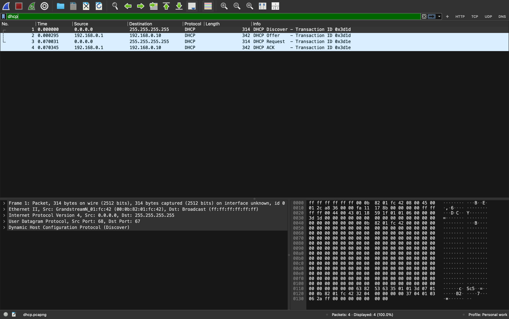
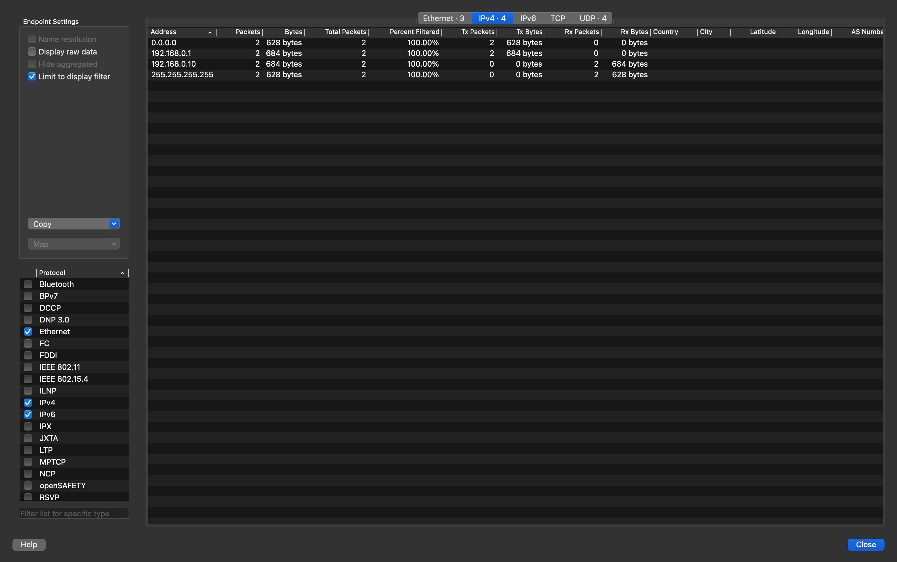
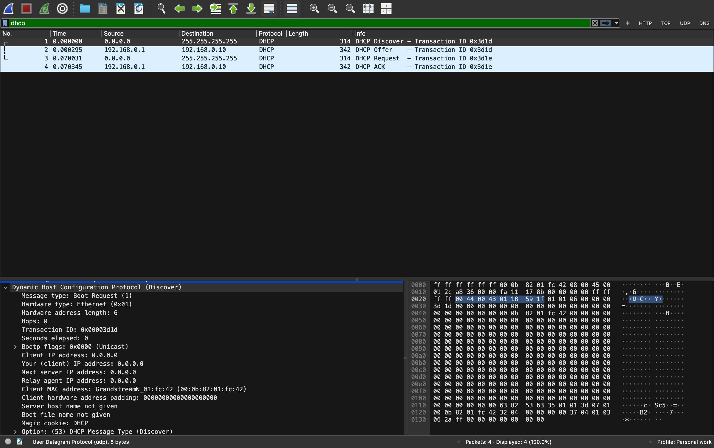
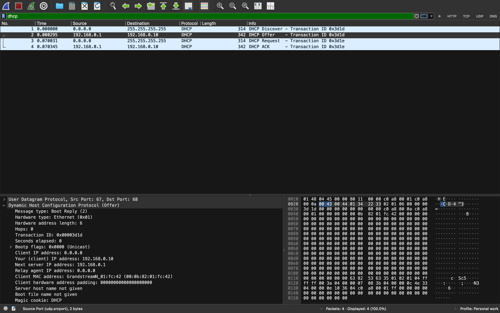
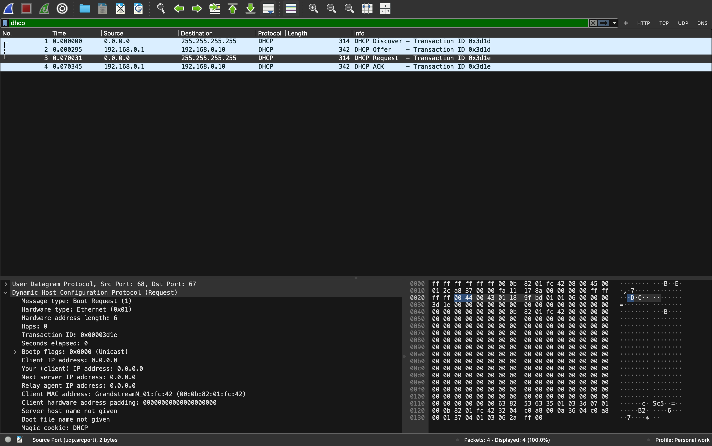
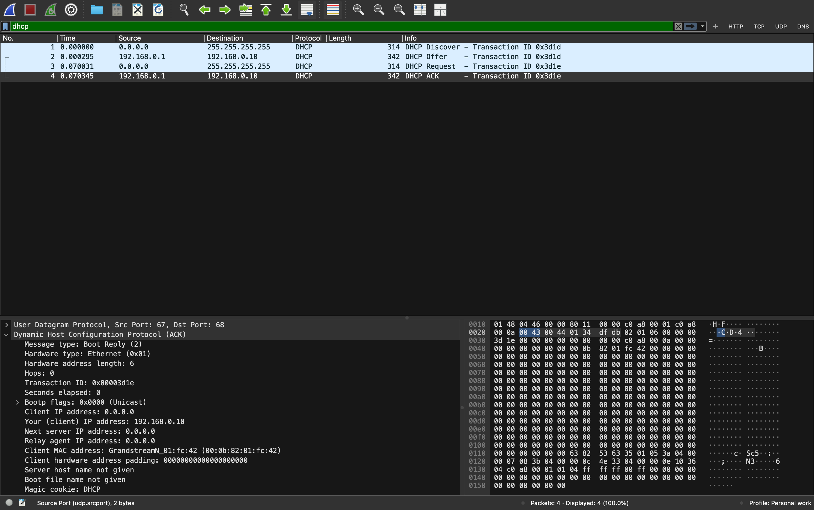
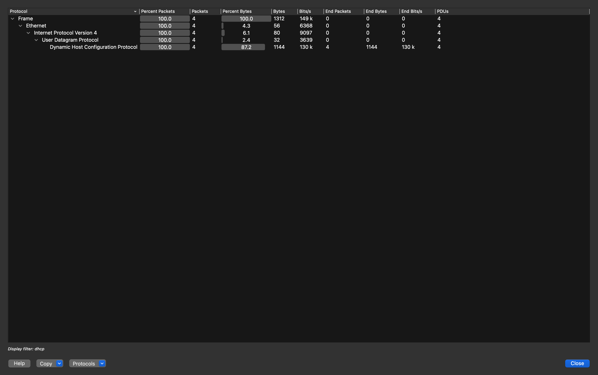
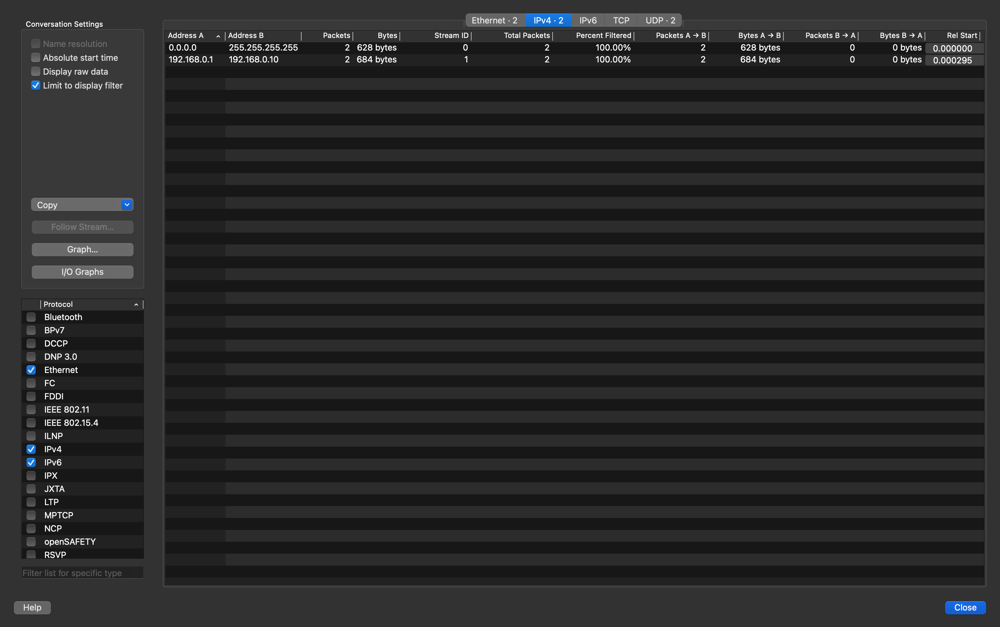

# DHCP Traffic Analysis

## Objective

Analyze the DHCP exchange and establish a baseline for normal IPv4 address acquisition in the captured lab environment.

## Executive summary

The capture shows a complete and successful **DORA** exchange:

```text
Client                         DHCP server (192.168.0.1)
  |  DHCP Discover (broadcast)          |
  |------------------------------------>|
  |  DHCP Offer: 192.168.0.10           |
  |<------------------------------------|
  |  DHCP Request (broadcast)           |
  |------------------------------------>|
  |  DHCP ACK: 192.168.0.10             |
  |<------------------------------------|
```

All four expected message types appear once. The observed session begins at `0.000000 s` and ends at `0.070345 s`.

## Packet timeline

| No. | Time (s) | Source → Destination | UDP ports | DHCP message | Transaction ID | Length |
|---:|---:|---|---|---|---|---:|
| 1 | 0.000000 | `0.0.0.0` → `255.255.255.255` | 68 → 67 | Discover | `0x3d1d` | 314 B |
| 2 | 0.000295 | `192.168.0.1` → `192.168.0.10` | 67 → 68 | Offer | `0x3d1d` | 342 B |
| 3 | 0.070031 | `0.0.0.0` → `255.255.255.255` | 68 → 67 | Request | `0x3d1e` | 314 B |
| 4 | 0.070345 | `192.168.0.1` → `192.168.0.10` | 67 → 68 | ACK | `0x3d1e` | 342 B |

**Observed timing**

- Discover → Offer: **0.295 ms**
- Request → ACK: **0.314 ms**
- Start → final ACK: **70.345 ms**



## Addressing and roles

| Role | IP address | Evidence |
|---|---|---|
| Unconfigured DHCP client | `0.0.0.0` | Source of Discover and Request broadcasts |
| DHCP server | `192.168.0.1` | Source of the Offer and ACK |
| Offered/acknowledged client address | `192.168.0.10` | `Your (client) IP address` in Offer and ACK |
| Broadcast destination | `255.255.255.255` | Destination of Discover and Request |

The client hardware address shown in the DHCP packet details is `00:0b:82:01:fc:42` (`GrandstreamN_01:fc:42` as resolved by Wireshark).



## Message-by-message evidence

### 1. DHCP Discover

- **Transport:** `0.0.0.0:68` → `255.255.255.255:67`
- **BOOTP message type:** Boot Request
- **Transaction ID:** `0x00003d1d`
- **Client IP / your IP / relay IP:** all `0.0.0.0`
- **DHCP option 53:** Discover

The broadcast is expected because the client has not yet configured an IPv4 address.



### 2. DHCP Offer

- **Transport:** `192.168.0.1:67` → `192.168.0.10:68`
- **BOOTP message type:** Boot Reply
- **Transaction ID:** `0x00003d1d` — matches the Discover
- **Your (client) IP address:** `192.168.0.10`
- **Next server IP address:** `192.168.0.1`
- **DHCP option 53:** Offer

This is the server's proposed lease address for the client.



### 3. DHCP Request

- **Transport:** `0.0.0.0:68` → `255.255.255.255:67`
- **BOOTP message type:** Boot Request
- **Transaction ID:** `0x00003d1e`
- **DHCP option 53:** Request

The Request is broadcast. The packet details identify the same client MAC address seen in the Discover. The capture shows a new transaction ID for the Request/ACK pair, so matching should use the relevant transaction pair and client MAC, not timing alone.



### 4. DHCP ACK

- **Transport:** `192.168.0.1:67` → `192.168.0.10:68`
- **BOOTP message type:** Boot Reply
- **Transaction ID:** `0x00003d1e` — matches the Request
- **Your (client) IP address:** `192.168.0.10`
- **DHCP option 53:** ACK

The ACK completes the observed lease acquisition and confirms the assignment of `192.168.0.10`.



## Protocol composition

Wireshark's protocol hierarchy for the DHCP-filtered packets reports:

| Layer | Packets | Bytes | Share of bytes |
|---|---:|---:|---:|
| Frame | 4 | 1,312 | 100.0% |
| Ethernet | 4 | 56 | 4.3% |
| IPv4 | 4 | 80 | 6.1% |
| UDP | 4 | 32 | 2.4% |
| DHCP | 4 | 1,144 | 87.2% |



## Conversation baseline

Wireshark reports two IPv4 conversations in the filtered view:

| Conversation | Packets | Bytes | Direction seen |
|---|---:|---:|---|
| `0.0.0.0` ↔ `255.255.255.255` | 2 | 628 B | Client broadcasts Discover and Request |
| `192.168.0.1` ↔ `192.168.0.10` | 2 | 684 B | Server sends Offer and ACK |



## Baseline conclusion

The DHCP traffic is consistent with a normal successful lease assignment:

- Four expected DORA message types are present in order.
- DHCP uses the expected UDP port direction: client `68 → 67`, server `67 → 68`.
- The address offered in the Offer (`192.168.0.10`) is the address acknowledged in the ACK.
- No retransmission or error is visible within this four-packet sample.

This small capture can serve as a reference when comparing future DHCP traces for missing phases, unexpected server addresses, duplicate offers, delayed acknowledgements, or retransmitted requests.
